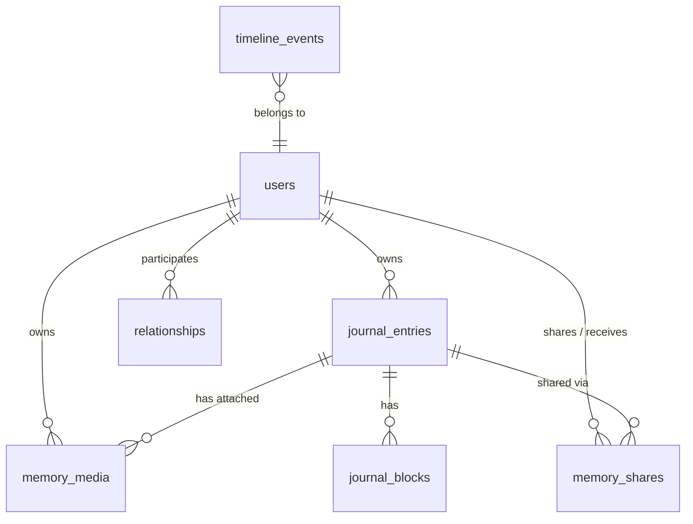

# Mementra — Current Storage Architecture & Image Display Problem Audit

**Date:** November 2026  
**Auditor:** Antigravity Engineering  
**System:** Mementra Media & Storage Subsystem

---

## 1. Existing Storage Architecture

The existing Mementra storage subsystem consists of:
- **`App\Services\Storage\MediaStorageInterface`**: Defines basic storage primitives (`upload`, `download`, `delete`, `exists`, `metadata`).
- **`App\Services\Storage\GoogleDriveMediaStorage`**: Implementation designed for a centralized, application-wide developer Google Drive account using credentials from `config('services.google_drive.*')`.
- **`App\Services\Storage\LocalTestMediaStorage`**: Fallback storage implementation writing to the Laravel `local` disk (`storage_path('app/private')`).
- **`App\Providers\AppServiceProvider`**: Registers a singleton/scoped binding for `MediaStorageInterface` that checks `config('services.google_drive.client_id')` and defaults to `LocalTestMediaStorage`.
- **`App\Services\MediaService`**: High-level service that receives an `UploadedFile`, extracts mime types and dimensions, calls `MediaStorageInterface::upload`, and persists a `MemoryMedia` Eloquent model record in MySQL.
- **`App\Models\MemoryMedia`**: Represents media assets attached to memories/journal entries. Contains columns for `user_id`, `journal_entry_id`, `type`, `storage_provider`, `provider_file_id`, `original_filename`, `mime_type`, `size_bytes`, `width`, `height`, and `metadata`.
- **`App\Http\Controllers\Web\MediaController`**: Contains `show(MemoryMedia $media)` which authorizes the request via `MemoryMediaPolicy` and streams bytes via `response()->stream(...)`.

---

## 2. Existing Media Upload Flow

1. **User Action**: The user selects image files in `JournalCreate` (`resources/js/pages/journal/create.tsx`) or `JournalEdit` (`resources/js/pages/journal/edit.tsx`).
2. **Form Submission**: The frontend appends files into `FormData` as `images[0]`, `images[1]`, etc. and posts to `/journal` (`JournalController::store`) or `/journal/{id}` (`JournalController::update`).
3. **Validation**: Handled by `StoreJournalEntryRequest` / `UpdateJournalEntryRequest`, verifying `images.* => ['file', 'image', 'max:10240']`.
4. **Service Dispatch**: `JournalEntryService` iterates through the uploaded files and invokes `MediaService::uploadMedia($user, $imageFile, $entry->id)`.
5. **Storage Invocation**: `MediaService` calls `$this->storage->upload(...)` with:
   - `path: $file->getClientOriginalName()`
   - `contents: file_get_contents(...)`
   - `mimeType: $mimeType`
   - `folder: "mementra/user-{$user->id}"`
6. **Storage Handling**:
   - In `LocalTestMediaStorage`, files are stored under `storage_path("app/private/mementra/user-{$user->id}/{$originalFilename}")`.
   - In `GoogleDriveMediaStorage`, the driver attempts a multipart upload to Google Drive v3 API using a single developer refresh token, specifying the folder path as a parent ID.
7. **Database Persistence**: A `MemoryMedia` record is created inside a database transaction, storing `$storageResult->provider` (`local_test` or `google_drive`) and `$storageResult->fileId` (`mementra/user-X/filename.jpg` or Google Drive file ID).

---

## 3. Existing Media Retrieval Flow

1. **Page Load**: When viewing `/memories`, `/journal/{id}`, `/journal/{id}/edit`, or `/timeline`:
   - Controllers resolve `MemoryMediaResource` items.
   - Frontend components receive media metadata (`id`, `original_filename`, etc.) but **no URL field** is generated by `MemoryMediaResource`.
2. **Image Request**: The frontend image tag hardcodes ``.
3. **Routing**: Route `/media/{media}/file` routes to `MediaController::show(MemoryMedia $media)` under `['auth', 'verified']` middleware.
4. **Authorization**: `MemoryMediaPolicy::view` checks if `$media->user_id === $user->id` or if the user is authorized to view the attached `journalEntry`.
5. **Content Fetching**: `MediaService::getMediaContents($media)` delegates to `$this->storage->download($media->provider_file_id)`.
6. **HTTP Response**: `MediaController::show` streams the retrieved raw string bytes to the browser with headers:
   - `Content-Type: $media->mime_type`
   - `Content-Disposition: inline; filename="..."`
   - `Cache-Control: private, max-age=86400`

---

## 4. Root Causes of the Image Display Problem

Our audit identified **four interconnected root causes** that break image display:

### Root Cause A: Storage Provider Decoupling & Resolution Mismatch
`MediaService` injects a single global instance of `MediaStorageInterface` resolved at boot time in `AppServiceProvider`.
However, individual `MemoryMedia` rows record distinct storage providers in their `storage_provider` column (such as `'google_drive'` or `'local_test'`).
- The database migration for `memory_media` specifies `$table->string('storage_provider')->default('google_drive')`, and factories also default to `'google_drive'`.
- In local or test environments without developer Google Drive credentials in `config/services.php`, `AppServiceProvider` resolves `LocalTestMediaStorage`.
- When a user requests an image with `storage_provider = 'google_drive'`, `MediaService` delegates to `LocalTestMediaStorage::download(...)`.
- `LocalTestMediaStorage` searches `Storage::disk('local')` for the Google Drive file ID (e.g., `1Abc...`), which does not exist locally.
- `Storage::disk('local')->get(...)` returns `null` or `""`.
- `MediaController::show` streams **0 bytes** with `Content-Type: image/jpeg`. The browser attempts to render empty bytes as an image, resulting in a **broken image icon**.
- Conversely, if centralized Google Drive credentials were configured, any media stored under `local_test` or another provider crashes `GoogleDriveMediaStorage` with API 404/400 errors.

### Root Cause B: Flawed Streamed Response & Missing Content-Length
`MediaController::show` returns:
```php
$contents = $this->service->getMediaContents($media);

return response()->stream(
    function () use ($contents) {
        echo $contents;
    },
    200,
    [
        'Content-Type' => $media->mime_type,
        'Content-Disposition' => 'inline; filename="'.$media->original_filename.'"',
        'Cache-Control' => 'private, max-age=86400',
    ]
);
```
- It loads the entire binary file into PHP process memory as a string, then executes `response()->stream()` using `echo $contents`.
- Symfony's `StreamedResponse` uses chunked transfer encoding and omits the `Content-Length` header. Certain browser engines, caching proxies, and image renderers fail or display empty frames when binary image responses lack `Content-Length` or when output buffers contain leading whitespace.
- There is no error handling or empty check: if `$contents` is empty or missing, HTTP 200 is still returned instead of an appropriate HTTP 404 / 422 response.

### Root Cause C: Google Drive API Parent Parameter Defect
In `GoogleDriveMediaStorage::upload`:
```php
$targetFolder = $folder ?? $this->folderId;
if ($targetFolder) {
    $metadata['parents'] = [$targetFolder];
}
```
`MediaService` passes `folder: "mementra/user-{$user->id}"`.
The Google Drive v3 API `parents` field expects an array of **Google Drive Folder IDs** (e.g. `1a2b3c4d5e...`), **not** a slash-delimited folder path. When an upload runs against Google Drive, the API rejects it with an invalid parent error.

### Root Cause D: Lack of URL Abstraction & Frontend Fallbacks
- `MemoryMediaResource` omits a `url` attribute. Every frontend view (`memories/index.tsx`, `journal/show.tsx`, `journal/edit.tsx`, `timeline/index.tsx`) constructs `/media/${m.id}/file` manually.
- The frontend `` elements lack `onError` handlers, loading skeletons, retry controls, and broken-image fallbacks. Any network glitch, auth delay, or missing file results in an unhandled broken image badge.

---

## 5. Affected Controllers, Models, Services, and Frontend Components

### Backend
1. **`app/Http/Controllers/Web/MediaController.php`**: Response handling, streaming, Content-Length, error handling.
2. **`app/Services/MediaService.php`**: Provider resolution based on media record and user connection.
3. **`app/Services/Storage/MediaStorageInterface.php`**: Contract needs modernization for per-user storage, streams, DTOs.
4. **`app/Services/Storage/GoogleDriveMediaStorage.php`**: Needs refactoring from centralized developer account to per-user OAuth tokens and folder management.
5. **`app/Services/Storage/LocalTestMediaStorage.php`**: Needs unique path hashing and proper stream retrieval.
6. **`app/Models/MemoryMedia.php`**: Needs connection relationship (`storage_connection_id`), owner relationship, and computed URL helpers.
7. **`app/Http/Resources/Api/V1/MemoryMediaResource.php`**: Needs `url`, `thumbnail_url`, and owner details.
8. **`app/Policies/MemoryMediaPolicy.php`**: Needs expansion for downloads, copying, and shared partner access.
9. **`app/Providers/AppServiceProvider.php`**: Needs registration of storage manager and resolver.

### Frontend
1. **`resources/js/pages/memories/index.tsx`**: Gallery display, loading states, error fallbacks, download/save to Drive.
2. **`resources/js/pages/journal/show.tsx`**: Attached photos, zoom/preview, download and Save to My Drive actions.
3. **`resources/js/pages/journal/edit.tsx`**: Existing photos management, preview fallbacks.
4. **`resources/js/pages/timeline/index.tsx`**: Thumbnail previews with fallback handling.
5. **`resources/js/types/`**: Update media interfaces to include URLs and storage statuses.

---

## 6. Existing Database Relationships



In the current schema:
- `memory_media.user_id` tracks the uploader.
- `memory_media.journal_entry_id` links to the journal entry (nullable).
- There is currently **no table** tracking per-user Google Drive connections or independent saved copies.

---

## 7. Potential Backward Compatibility Issues

1. **Existing Media Rows**: Existing rows in `memory_media` have `storage_provider` as `'google_drive'` or `'local_test'` and have no `storage_connection_id`. The system must gracefully handle legacy media without breaking or crashing.
2. **Route URLs**: Existing frontend components call `/media/{media}/file`. This route must be preserved while adding `/media/{media}/download` and `/media/{media}/save-to-drive`.
3. **Local Development & Testing**: Automated tests rely on `LocalTestMediaStorage` and `Storage::fake('local')`. The storage architecture must support local/test providers seamlessly without requiring real Google credentials during unit/feature test runs.

---

## 8. Recommended Implementation Plan

1. **Fix Image Display Immediately**:
   - Provide proper provider resolution in `MediaService` so that media records are fetched using the driver matching their `storage_provider`.
   - Update `MediaController::show` to return proper binary responses with `Content-Length`, `Content-Type`, and graceful error handling.
   - Add `url` and `download_url` to `MemoryMediaResource`.
   - Add error fallback and loading state support to frontend media components.
2. **Build Storage Abstraction Layer (Phase 2)**:
   - Introduce `StorageProviderInterface`, `StorageManager`, `StorageResolver`, and DTOs (`StoredFile`, `UploadResult`).
3. **Implement Storage Connection & OAuth (Phases 3-6)**:
   - Migration for `storage_connections` (user-specific tokens, encrypted at rest, status tracking).
   - Migration for `saved_media` (independent cross-user copies).
   - Google Drive OAuth Web Flow (least privilege `drive.file` scope, token refresh, folder provisioning `Mementra/Memories/YYYY/Memory_XXX`).
4. **Implement Media Operations & Shared Access (Phases 7-11)**:
   - Secure upload to user's personal Google Drive.
   - Secure retrieval and streaming via backend proxy.
   - Authenticated download endpoint.
   - Cross-account "Save to My Drive" independent copy workflow (stream User A -> upload User B).
5. **Settings UI & Account Management (Phases 12-15)**:
   - `/settings/integrations` with Google Drive Connect / Disconnect / Reconnect / Status in English and Arabic.
6. **Media Migration Command (Phase 16)**:
   - `php artisan mementra:media-migrate-to-drive` with dry-run support.
7. **Comprehensive Testing & Documentation (Phases 17-21)**:
   - Automated Pest tests covering all 7 ownership scenarios, token refresh, policies, and failure modes.

