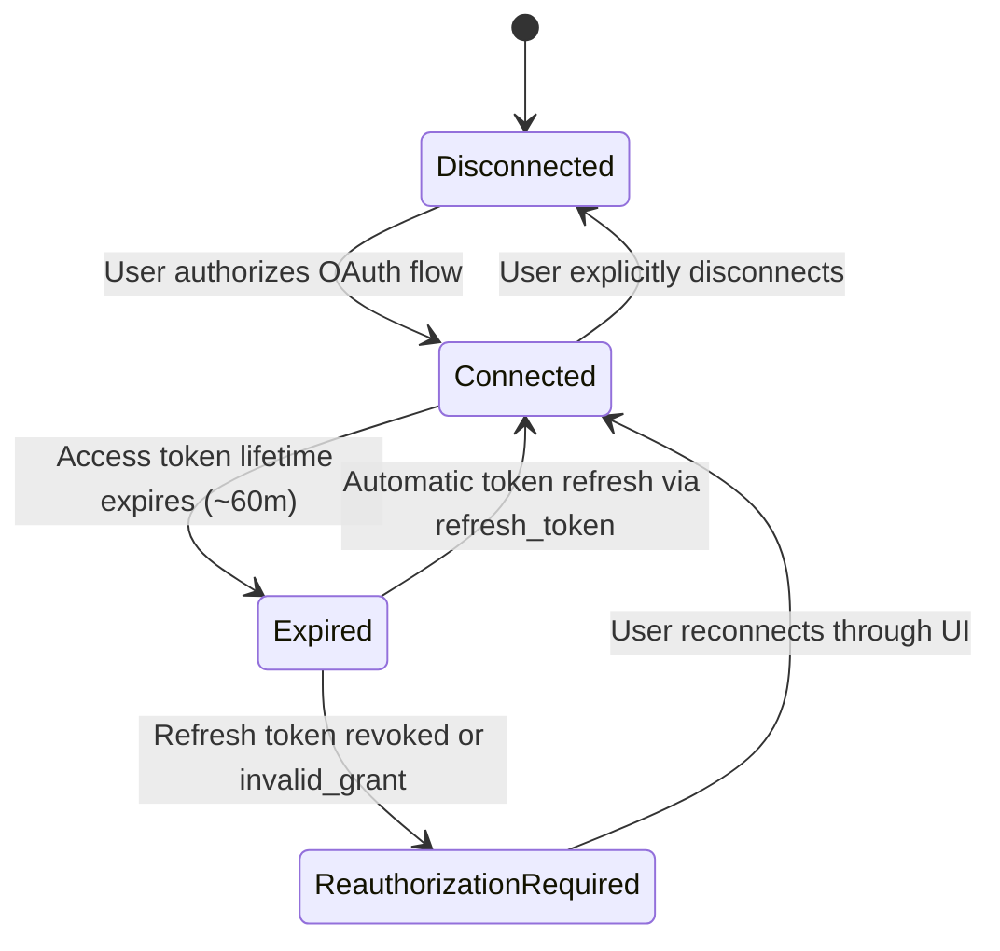

# Google Drive Integration Guide

## 1. Overview

Mementra integrates directly with Google Drive via the official **Google Drive API v3** and **OAuth 2.0 Web Server Flow**. Every user connects their own personal Google Drive account.

Files are stored privately in user accounts under a dedicated application directory:
```
Google Drive/
└── Mementra/
    ├── Memories/
    │   └── {Year}/
    │       └── Memory_{JournalEntryId}/
    │           ├── beach_walk.jpg
    │           └── candle_dinner.png
    └── Saved Memories/
        └── shared_photo_copy.jpg
```

---

## 2. Distinction: Sign in with Google vs. Connect Google Drive

Mementra maintains strict independence between user authentication and cloud storage authorization:
- **Sign In / Registration**: Authenticates the user into Mementra via email/password or standard identity login (`openid`, `email`, `profile`).
- **Connect Google Drive**: Dedicated storage authorization under Settings (`/settings/integrations`). Requests Google Drive storage permissions independently.

A user may:
- Register with email/password and later connect Google Drive.
- Disconnect Google Drive without logging out or losing their Mementra account.
- Reconnect a different Google Drive or update permissions at any time.

---

## 3. Scope Configuration

Mementra uses the least-privilege scope:
```text
https://www.googleapis.com/auth/drive.file
```
**Why `drive.file`?**
- Grants access only to files and folders created or explicitly opened by Mementra.
- Does **not** grant read or write permissions to the user's existing files, documents, photos, or spreadsheets elsewhere in their Google Drive.
- Protects user privacy and complies with Google API User Data Policy for restricted scopes.

---

## 4. Lifecycle of a Storage Connection



### Connection States (`StorageConnectionStatus`)
1. **`connected`**: Connection active, tokens valid.
2. **`disconnected`**: User voluntarily disconnected; tokens cleared.
3. **`expired`**: Access token expired; will be automatically refreshed on the next operation.
4. **`reauthorization_required`**: Refresh token has expired, been revoked, or the account password changed; user must click "Reconnect".
5. **`error`**: API error or quota limit reached.

---

## 5. Token Storage & Encryption

Tokens are encrypted at rest using Laravel's application key:
```php
protected function casts(): array
{
    return [
        'access_token' => 'encrypted',
        'refresh_token' => 'encrypted',
        'token_expires_at' => 'datetime',
        'status' => StorageConnectionStatus::class,
    ];
}
```
Tokens are never sent to the frontend or exposed in API/Inertia props.

