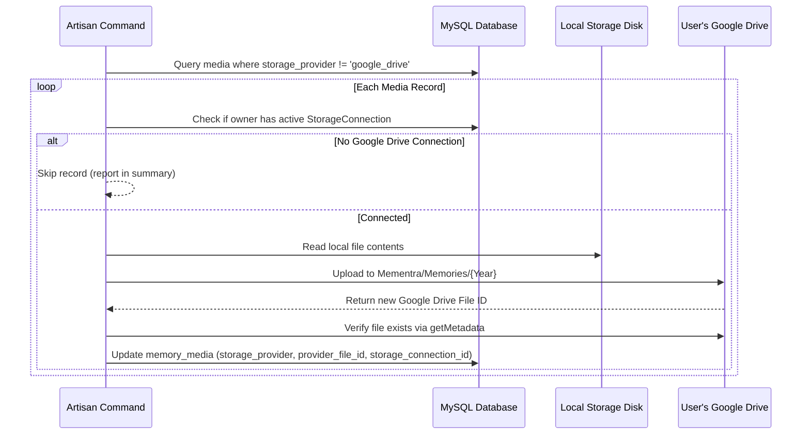

# Existing Media Migration Guide

## 1. Overview

Mementra provides a safe, non-destructive migration command to transfer legacy local media files to users' personal Google Drive accounts once they connect.

Command:
```bash
php artisan mementra:media-migrate-to-drive
```

---

## 2. Safety & Verification Guarantees

The migration command adheres to the following rules:
1. **Never Deletes Unverified Files**: The source local file is preserved. Database references are only updated after Google Drive confirms the upload was successful and the file exists.
2. **Requires Active User Connection**: If a media file belongs to a user who has not connected Google Drive, the file is skipped safely without errors.
3. **Dry-Run Support**: Inspect all candidate files, owners, and expected destinations without transferring any bytes.
4. **Targeted Migration**: Migrate a specific user by providing `--user={id}`.
5. **Idempotent**: Can be safely run multiple times. Once a media record is updated to `storage_provider = 'google_drive'`, subsequent runs skip it.

---

## 3. Usage & Command Flags

### Preview Candidate Media (Dry-Run)
```bash
php artisan mementra:media-migrate-to-drive --dry-run
```
Outputs a summary table of how many files would be migrated, how many users need to connect Drive, and any missing local files.

### Migrate Specific User
```bash
php artisan mementra:media-migrate-to-drive --user=1
```

### Full Migration (Non-Interactive / Production Job)
```bash
php artisan mementra:media-migrate-to-drive --force
```

---

## 4. Migration Flow



